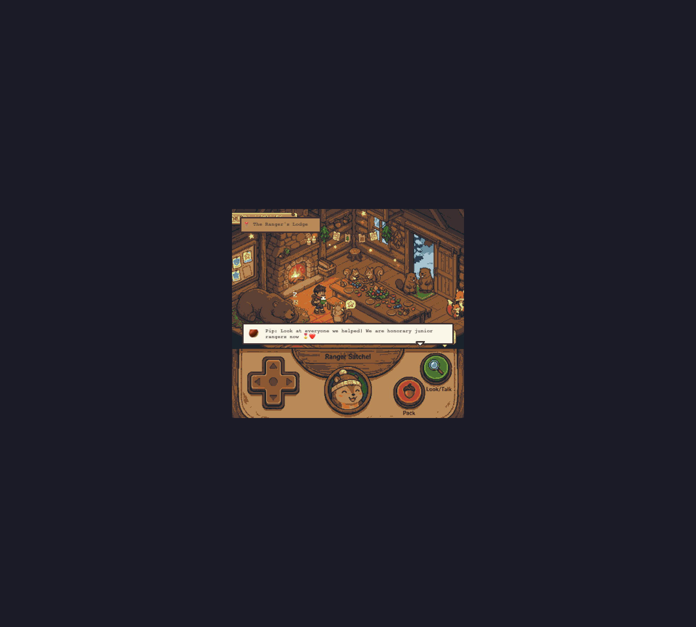
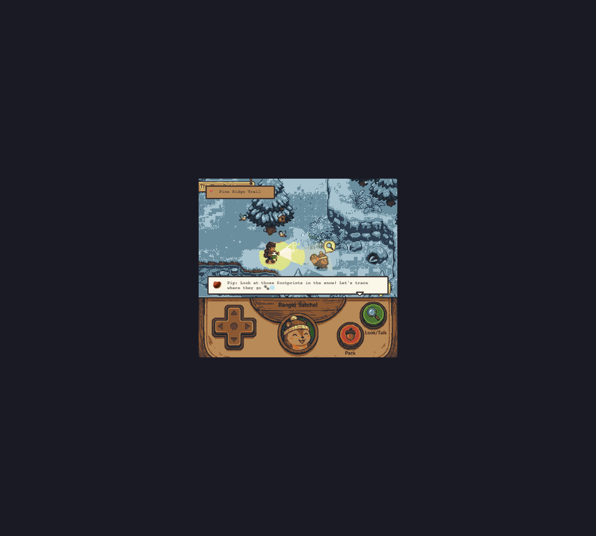
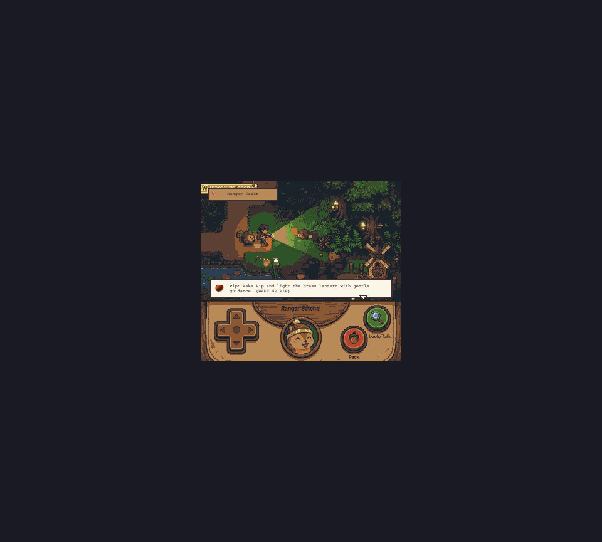
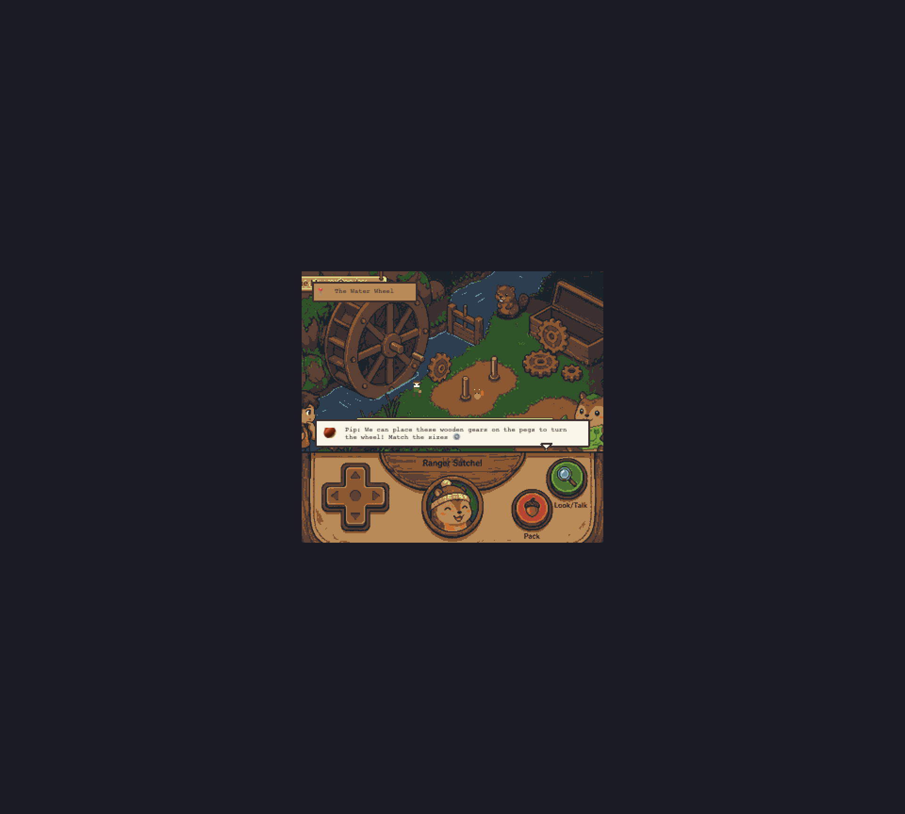
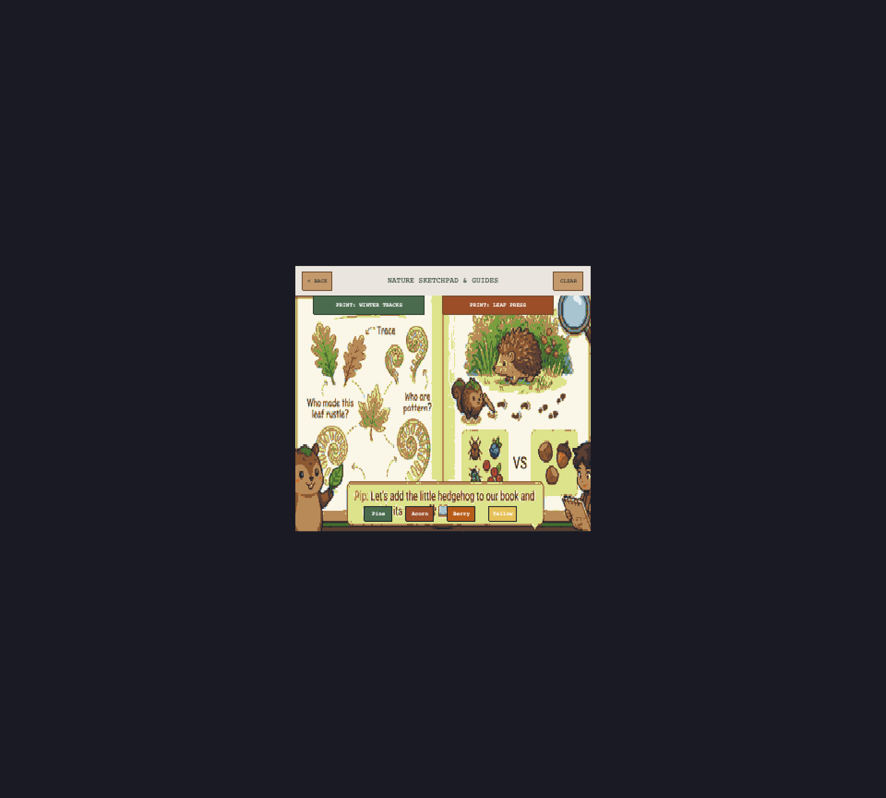
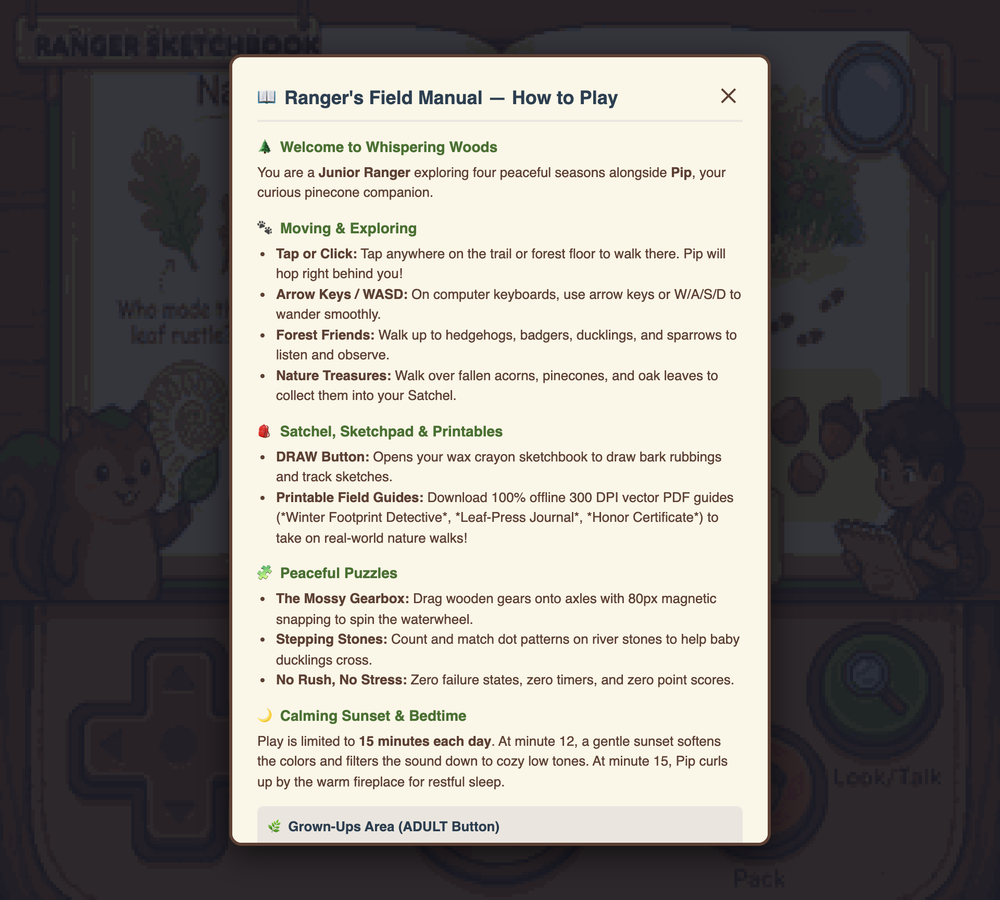
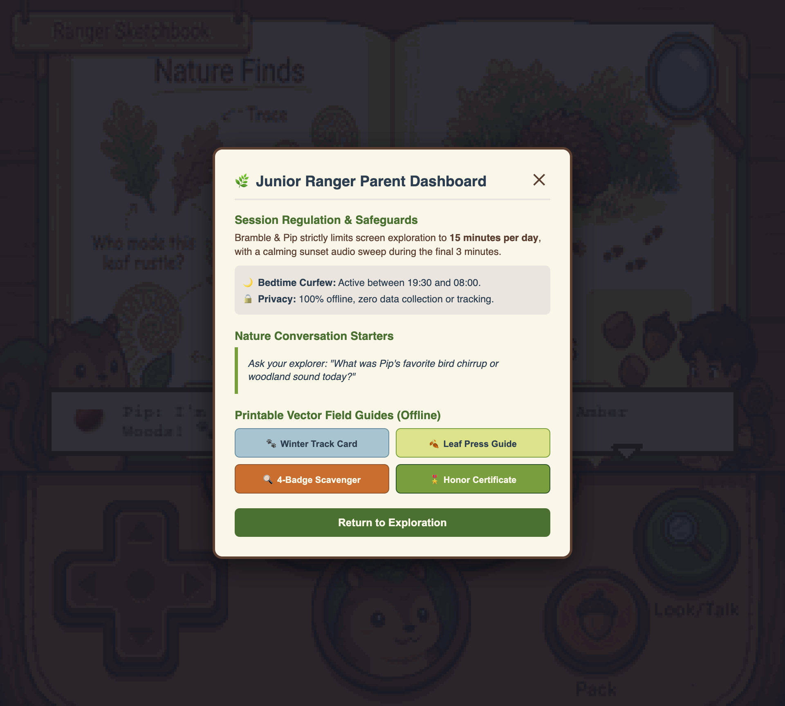
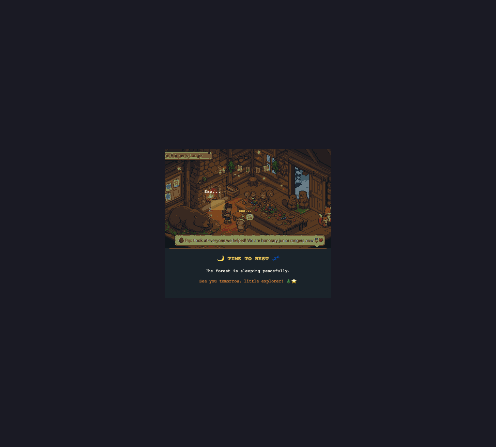

# Bramble & Pip 🌲🐾

A calm, non-addictive, offline-first pedagogical nature adventure for children under seven, inspired by the top-down exploration of *Pokémon Yellow*, but built around real-world nature observation, acoustic audio, and physical offline activities.

▶ **Live Game (GitHub Pages):** [https://franekjemiolo.github.io/bramble-and-pip/](https://franekjemiolo.github.io/bramble-and-pip/)  
▶ **Repository:** [https://github.com/FranekJemiolo/bramble-and-pip](https://github.com/FranekJemiolo/bramble-and-pip)

---

## 📸 In-Game Visual Showcase

| The Ranger's Lodge Celebration (Ch 20) | The Pine Ridge Winter Trail (Ch 16) |
|:---:|:---:|
|  |  |
| *End-of-campaign celebration feast in the warm cabin with sleeping bear, harvest feast, beavers, and foxes.* | *Winter tracking trail in the snow with chickadees, badger burrow, rabbit pawprints, and flashlight beam.* |

| Whispering Woods Exploration (Ch 1) | The Mossy Gearbox (Ch 7) |
|:---:|:---:|
|  |  |
| *Bramble & Pip exploring the forest with the carved wooden Ranger Satchel, Pip cameo medallion, and D-pad.* | *Tactile gear-meshing puzzle: place matching wooden cogs onto axles to turn the river waterwheel.* |

| 20-Chapter Four-Season Trail Map | Nature Sketchpad & Field Journal |
|:---:|:---:|
|  |  |
| *Seamless chapter progression matrix spanning all 4 seasons with completion badges and direct travel.* | *Illustrated nature field journal with wax crayon pigments, track-spotting guides, and offline PDF printables.* |

| In-Game Ranger's Field Manual | Grown-Up Dashboard |
|:---:|:---:|
|  |  |
| *Accessible in-game pictorial field guide teaching unhurried movement, Pip companion interactions, and puzzles.* | *Parent area protected by a word-math gate, featuring nature conversation starters and screen limits.* |

| Nocturnal Bedtime Curfew |
|:---:|
|  |
| *At 15 minutes (or 7:30 PM), twilight settles across the lodge with gentle ember flickers and peaceful rest.* |

---

## 📖 How to Play: Field Guide & Tutorial

### 🌟 For Young Explorers & Children

#### 1. Walking Along the Trail
- **Tap or Click to Walk:** Tap anywhere on the grass or path to guide Bramble. An intelligent forest pathfinder will find the gentlest route around trees, fences, and ponds.
- **Arrow Keys & WASD:** On computers or keyboards, use the **W, A, S, D** or **Arrow Keys** to stroll in any direction. Bramble moves at an unhurried, comfortable pace (64 pixels per second) and smoothly slides around fence corners.

#### 2. Your Faithful Companion, Pip
- Pip the puppy follows close behind you, exactly one step behind your footprints.
- **Curiosity:** Watch Pip's ears prick up, tail wag, and little speech thoughts appear when interesting nature items or animal friends are near!
- Pip will let out a gentle acoustic chirrup whenever you discover something new in the woods.

#### 3. Meeting Woodland Animals
- Stroll near the animals resting along the trail:
  - 🦔 **Hedgehog:** Snuffling quietly near the woodpile.
  - 🦆 **Duckling:** Paddling gently near the pond lilies.
  - 🐦 **Sparrow:** Perched on a trail boulder, greeting the morning.
  - 🐇 **Rabbit:** Munches clover near the flower meadow.
  - 🦡 **Badger:** Inspects soft earth under the fallen logs.
- Step close to an animal to see their gentle, non-reader friendly thoughts and hear their soft nature sounds.

#### 4. Collecting Nature Treasures
- Keep an eye out for fallen **oak leaves**, golden **acorns**, and pine **cones** scattered along the forest floor.
- Walk over them to gently scoop them into your wooden satchel with a soft water-drop chime.
- Inspect your findings anytime by checking your satchel tokens at the bottom of the screen.

#### 5. Solving Trail Puzzles
- **Stepping Stone Crossing (Chapter 3):** To cross Pebble Creek, look at the dot patterns on the stones. Step on the stones in order (from 1 dot to 5 dots) to safely hop across the babbling brook.
- **The Mossy Gearbox (Chapter 7):** The waterwheel has stopped turning! Drag the wooden cogs from your tray onto the matching axles to mesh the gears and restart the clear water flow.
- All puzzles are completely stress-free: pieces gently return to their tray if mismatched, with zero penalty buzzers or failure screens.

#### 6. The Nature Sketchbook & Wax Crayons
- Tap the **pencil token** on your satchel to open your wooden drawing easel.
- Pick from 16 nature-inspired wax crayon colors (moss green, bark brown, acorn gold, sunset coral).
- Draw freely on the parchment using your finger or mouse with smooth, textured crayon strokes.
- Tap **Clear** to start fresh, or tap **Print Field Guides** to have a grown-up generate real-world nature crafts!

#### 7. Gentle Sunset & Bedtime Resting
- After 12 minutes of exploration, the Whispering Woods slowly transitions into a warm amber sunset over 3 peaceful minutes.
- The forest music softly lowers its high notes, guiding energy down.
- At 15 minutes (or during evening hours after 7:30 PM), Bramble and Pip head back to the Ranger Cabin to curl up by the cozy fireplace for a restful night of sleep.

---

### 👨‍👩‍👧 For Parents, Guardians & Educators

#### 1. Unlocking the Grown-Up Dashboard
- Tap the wooden **"ADULT"** token on the bottom-right corner of the Satchel bar.
- A multiplication word-math gate appears (e.g., *"What is three multiplied by seven?"*). This ensures young children cannot accidentally modify settings.
- Incorrect attempts immediately generate a fresh challenge, and 3 consecutive errors engage a 60-second peaceful cooldown.

#### 2. Meaningful Screen Time Regulation
- **Monotonic 15-Minute Exploration Ceiling:** Tracked via `performance.now()`. Children cannot bypass the timer by refreshing the page or restarting the browser.
- **180-Second Sunset Ramp:** Starting at minute 12, an 18-step warm color grading and Web Audio low-pass filter ($18\text{ kHz} \to 2.2\text{ kHz}$) gently wind down sensory stimulation before the session ends.
- **Evening Bedtime Lock:** Automatically enters resting mode between 19:30 and 08:00 local time, preventing late-night blue-light exposure.

#### 3. Real-World Nature Bridging
- The Parent Dashboard tracks what your child has observed during their session (e.g., *Oak Leaves*, *River Lilies*, *Hedgehogs*).
- Provides contextual outdoor inquiry prompts you can use on real-world nature walks:
  - *"We saw a hedgehog resting in the woods today—where do you think small creatures hide their nests in our local park?"*
  - *"Can you find three different shapes of fallen leaves on the sidewalk like Bramble collected?"*

#### 4. Offline Resolution-Independent Vector Printables
- Generate instant, print-ready PDF pocket activity guides directly in browser memory without sending any data over the internet:
  - **Winter Footprint Detective Guide:** 4 pocket cards teaching tracking identification.
  - **Autumn Leaf-Press Specimen Journal:** Real leaf preservation layout cards.
  - **Junior Ranger 4-Badge Scavenger Hunt:** Field checklist for outdoor observation.
  - **Junior Ranger Honor Certificate:** Printable award for completing nature chapters.

---

## 🏛 Core Architectural & Ethical Invariants

1. **Zero Network Egress:**
   - Content Security Policy: `default-src 'self'; script-src 'self'; style-src 'self' 'unsafe-inline'; img-src 'self' data: blob:; media-src 'self' data: blob:; connect-src 'none'; base-uri 'self'; object-src 'none'; form-action 'none';`
   - Zero telemetry, zero analytics SDKs, zero advertising endpoints, zero third-party font calls.
   - Complies strictly with COPPA and GDPR-K regulations.

2. **Anti-Addictive Session Regulation:**
   - Monotonic 15-minute daily exploration ceiling tracked via `performance.now()`.
   - At minute 12, a 180-second gradual sunset initiates:
     - 18-step warm amber color grading.
     - Exponential Web Audio low-pass filter sweep ($18\text{ kHz} \to 2.2\text{ kHz}$).
   - At minute 15, the game transitions into a serene nocturnal "Resting" state (`BedtimeScene`).
   - Clock rollbacks or midnight curfew (19:30 to 08:00) lock into peaceful rest.

3. **No Extrinsic Dopamine Loops:**
   - Zero streaks, zero daily login bonuses, zero random loot, zero confetti or slot-machine chimes.
   - Puzzles feature zero failure penalties or buzzers; incorrect moves gently return to their tray.

4. **Pediatric Motor Tolerance (Ages 3–6):**
   - **Single-Pointer Lock:** Rejects secondary finger contacts and accidental resting palms.
   - **12px Screen Perimeter Deadzone:** Eliminates edge-gripping "screen hug" touches.
   - **80px Magnetic Capture Basin:** Snaps puzzle pieces into alignment over a 200ms cubic ease-out.
   - **48px Bézier Corridor:** Provides forgiving gesture tracing with lift-and-resume progress preservation ($u \ge 0.92$).
   - **300ms Global Debounce:** Discards rapid "rage tapping".

5. **Acoustic & Visual Ergonomics:**
   - Master 16-color "Whispering Woods" indexed palette (no mixels, no anti-aliased blur, binary alpha).
   - $320 \times 288$ integer letterboxing centered on screen.
   - Unhurried pacing: 24–30 fps rendering, 64 px/s walking speed, 6 px corner sliding.
   - Acoustic procedural audio engine (pentatonic kalimba, woodblocks, gentle guitar, natural water bubble). Frequency strictly capped $<4.5\text{ kHz}$, attack $\ge 40\text{ms}$, peak $\le -12\text{ dBFS}$.
   - Silent HTML5 audio bridge bypasses the iOS hardware ringer switch.

---

## 🗺 The 20-Chapter Four-Season Progression Matrix

| Chapter | Season | Region | Narrative Objective | Pedagogical Interaction | Offline Bridge Sheet |
|---|---|---|---|---|---|
| **CH-01** | Spring | Ranger Cabin | Wake Pip & Light Lantern | Candle drag-and-drop to lantern | Cabin Orientation Card |
| **CH-02** | Spring | Pebble Creek West | Clear Winter Branches | Size-sorting logs into brush piles | Twig Collector Card |
| **CH-03** | Spring | Pebble Creek Central | Stepping Stone Subitizing | Count lily pad dots (1 to 5) to cross brook | Pond Stepping Card |
| **CH-04** | Spring | Meadow Edge | Budding Wildflowers | Color matching (Dandelion / Primrose) | Sprout Spotter Guide |
| **CH-05** | Spring | Bird Hollow | Robin Nest Building | Trace bird flight trajectory | Tiny Nest Craft Sheet |
| **CH-06** | Summer | Mossy Hollow Entrance | Clear Stream Debris | Horizontal sliding stone puzzle | Water Way Marker |
| **CH-07** | Summer | The Water Wheel | The Mossy Gearbox | Match 3 gear diameters to axles | Gear Cutout Kit |
| **CH-08** | Summer | Deep Hollow Shade | Insects in Log Shadows | Flashlight scanning in shaded zone | Bug Spotter Sheet |
| **CH-09** | Summer | Whispering Brook | Cooling Thirsty Friends | Water barrel drag-and-pour | Backyard Water Tracker |
| **CH-10** | Summer | Willow Bank | Comparing Leaf Shapes | Sorting oval willow vs. broad oak | Leaf Outline Card |
| **CH-11** | Autumn | Sunset Meadow West | Harvest Fallen Acorns | 1-to-1 counting into squirrel pouch | Acorn Match Card |
| **CH-12** | Autumn | Amber Woods | Tracing Dry Oak Leaves | Bézier finger tracing (48 px buffer) | Leaf-Press Guide |
| **CH-13** | Autumn | The Great Oak | Insulate Chipmunk Burrow | Drag dry moss and bark into nest | Burrow Insulator Sheet |
| **CH-14** | Autumn | Wind Ridge | Migrating Bird Flocks | Binocular search; trace V-formation | Sky Migration Map |
| **CH-15** | Autumn | Hollow Log Rest | Match Autumn Bird Calls | Acoustic 3-note pitch recognition | Sound Catcher Card |
| **CH-16** | Winter | Pine Ridge Trail | Rabbit Footprint Trail | Trace "Big Back, Small Front" prints | Winter Track Card A |
| **CH-17** | Winter | Frost Creek | Frozen Brook Crossing | Match log lengths to ice gaps | Stick Sizing Card |
| **CH-18** | Winter | Snow Pine Hollow | Pinecone Bird Feeders | Balance feeders on tree branches | DIY Pinecone Feeder |
| **CH-19** | Winter | The Badger Mound | Resting Woodland Friends | Soft flashlight scan inside burrow | Winter Sleeping Guide |
| **CH-20** | Winter | The Ranger's Lodge | Year-End Forest Reunion | Interactive feast; tap all animal friends | Ranger Honor Certificate |

---

## 🛠 Multi-Agent AI Tooling & Art Pipeline

- **Sprite Sanitizer (`scripts/process-sprite.js`):** Strips chroma-key backgrounds, clamps pixels to the 16-color Whispering Woods palette, and enforces binary alpha.
- **Local Art Pipeline MCP (`scripts/art-pipeline-mcp.js`):** JSON-RPC tool exposing `sanitize_sprite`, `audit_palette`, and `test_tile_seam` for automated asset generation.
- **Rules & Skills:**
  - `.agents/rules/art-pipeline.md`: 16-color palette, 320x288 resolution, zero mixels.
  - `.agents/rules/pedagogy-invariants.md`: Zero egress, anti-addictive limits, motor tolerance.
  - `.agents/skills/generate-sprite/SKILL.md`: Procedural sprite generation workflow.
- **Visual QA Testbed (`testbed.html`):** Isolated visual preview canvas for inspecting sprites, companion animations, autotiling Wang-sets, and flashlight Bayer dithering.

---

## 💻 Development & Verification Workflow

```bash
# Install dependencies
npm ci

# Start development server
npm run dev

# Run full static and compile-time checks
npm run typecheck
npm run lint

# Audit zero-egress invariants (source, bundle, and CSP)
npm run audit:egress

# Run Vitest unit & functional test suite (114 tests)
npm run test:unit

# Run Playwright E2E browser tests (including 100 Monte Carlo stochastic touch trials)
npm run test:e2e

# Compile production PWA bundle (dual entry: index.html & testbed.html)
npm run build

# Preview production build locally
npm run preview
```

---

## 📱 Mobile Distribution (Capacitor)

```bash
npm run build
npx cap add ios      # Generates Xcode iOS wrapper
npx cap add android  # Generates Android Studio wrapper
npx cap sync
```

---

## 📚 Architectural Documentation

- [`docs/VISION.md`](docs/VISION.md) — Pedagogical vision, anti-addictive charter, and sensory limits.
- [`docs/ARCHITECTURE.md`](docs/ARCHITECTURE.md) — Technical blueprint, Web Audio graphs, math models, and IndexedDB schemas.
- [`docs/MILESTONES.md`](docs/MILESTONES.md) — Gated phase deliverables and test acceptance criteria (Phases 0–7).
- [`docs/JOURNAL.md`](docs/JOURNAL.md) — Architectural decision records (ADRs) and living progress logs.

---

## License

MIT License — see [LICENSE](LICENSE).
